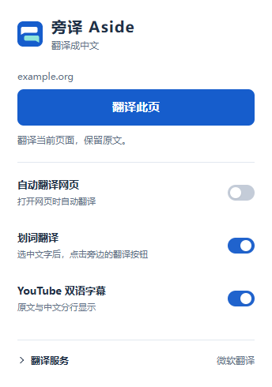
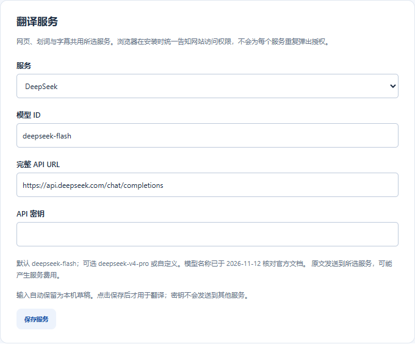

<p align="center">
  
</p>

<h1 align="center">旁译 Aside</h1>

<p align="center">网页双语阅读 · 划词翻译 · YouTube 双语字幕</p>

<p align="center">
  <a href="https://github.com/jking412/aside-translate/releases"></a>
  <a href="https://github.com/jking412/aside-translate/actions/workflows/ci.yml"></a>
  <a href="LICENSE"></a>
</p>

<p align="center">
  <strong><a href="https://github.com/jking412/aside-translate/releases/download/v0.3.1/aside-translate-0.3.1.zip">下载旁译</a></strong> ·
  <a href="#安装">安装指南</a> ·
  <a href="#翻译服务">配置 DeepSeek</a> ·
  <a href="https://github.com/jking412/aside-translate/issues">反馈问题</a>
</p>

旁译是一款面向 Chrome 和 Edge 的轻量翻译扩展。阅读外文网页时，在原文旁查看中文；遇到想细读的一句，选中即可翻译；观看 YouTube 时，用双语字幕对照理解。免费翻译开箱即用，也可以接入自己的 DeepSeek 或其他大模型。

<p align="center">
  
</p>

## 用旁译阅读

### 网页双语，保留阅读上下文

点击页面上的悬浮按钮或工具栏中的「翻译此页」，中文译文随段落呈现，原文始终可见。需要时一键恢复，也可以打开自动翻译，让之后访问的网页直接进入双语阅读。

- 支持滚动加载的新段落，阅读到哪里，翻译到哪里。
- 保留原文的链接和格式，方便对照阅读、继续浏览。
- 支持 `Alt+A` 翻译与恢复，`Alt+W` 打开快捷面板。

### 选中一句，单独翻译

选中文字后，点击选区旁的「翻译」，在浮窗中查看原文与中文译文。适合查阅一句说明、读懂一段引用，或在整页翻译前先看重点。

### YouTube，原文与译文一起看

打开带字幕的视频，旁译会读取可用字幕，在播放器内分行展示原文与中文。支持提前翻译，字幕大小随播放器调整，拖动进度或切换视频后跟随当前播放位置更新。

已有合适的人工中文字幕时优先使用，也可以选择自己的翻译服务。播放器内的翻译按钮与独立设置页都可以控制字幕。

## 安装

支持桌面版 **Chrome、Edge 及其他 Chromium 浏览器**，使用扩展无需安装 Node.js。

1. **[下载扩展 ZIP](https://github.com/jking412/aside-translate/releases/download/v0.3.1/aside-translate-0.3.1.zip)**，解压到一个固定文件夹。
2. 在 Chrome 中打开 `chrome://extensions`，或在 Edge 中打开 `edge://extensions`，开启「开发者模式」。
3. 点击「加载已解压的扩展」，选择包含 `manifest.json` 的文件夹。
4. 将旁译固定到工具栏，刷新网页，即可使用。

更新时，用新安装包替换原文件，在扩展管理页点击「重新加载」，再刷新已打开的网页。安装包与更新内容见 [Releases](https://github.com/jking412/aside-translate/releases)。目前通过 GitHub 分发。

## 翻译服务

**免费开始，按需选择 AI。** 网页、划词和字幕共用当前翻译服务，在弹窗中切换，也可以打开独立设置页配置。

### 免费翻译

默认使用微软翻译，无需注册旁译账户或填写密钥。也可切换到 Google 公共服务，服务可用性取决于所在网络。

### DeepSeek

DeepSeek 位于服务列表的**第二项**，直接选择即可配置。官方接口与默认模型已预填，填入自己的 API Key，点击「保存服务」后即可用于网页、划词和字幕翻译。

1. 在 [DeepSeek 开放平台](https://platform.deepseek.com/) 获取 API Key。
2. 打开旁译的「翻译服务」，选择 **DeepSeek**。
3. 输入 API Key，保存即可。需要其他模型时，可在模型栏选择或填写模型 ID。

<p align="center">
  
</p>

独立设置页会保持打开，各服务的输入也会保留为本机草稿，方便切去获取密钥后继续填写。DeepSeek API 按服务商规则计费。

### 更多模型与自定义服务

支持 OpenAI、通义千问、智谱 GLM、Kimi、豆包、硅基流动、Mistral、Groq、OpenRouter，以及 Claude、Gemini 和自备 LibreTranslate。可选择服务商预设，也可填写自己的兼容接口和模型 ID。配置方法见 [AI 服务指南](docs/ai-services.md)。

## 隐私

旁译无需账户，设置与 API Key 保存在当前浏览器本机。使用翻译时，待翻译文字会发送到你选择的服务，AI 请求使用你自己的密钥与额度。

自动翻译默认关闭，可以在插件中控制，并通过浏览器扩展详情管理网站访问范围。具体数据处理和存储方式见 [隐私说明](PRIVACY.md)。

## 常见问题

**视频没有显示双语字幕？**

先确认视频有可用字幕、播放器 CC 已打开，并检查所选翻译服务是否可用。旁译依赖 YouTube 提供字幕，部分视频或网络环境可能返回空字幕。只有屏幕字幕可读时，会尝试实时翻译，速度取决于服务响应。更多排查信息见 [使用与验证记录](docs/verification.md)。

**哪些页面可以翻译？**

支持普通网页及其中的文字内容。浏览器内部页面、扩展商店、PDF、图片与画布文字等场景暂不支持。

**如何反馈问题？**

请在 [Issues](https://github.com/jking412/aside-translate/issues) 提供浏览器版本、页面地址与复现步骤。涉及翻译服务时，附上服务商和模型名，提交前请遮挡 API Key 和个人信息。

## 开发与贡献

需要 Node.js 22+ 和 npm。

```sh
git clone https://github.com/jking412/aside-translate.git
cd aside-translate
npm ci
npm run build
```

构建后加载 `dist/`。修改源码后，重新构建、重新加载扩展并刷新网页。

```sh
npx playwright install chromium
npm run verify
npm run package
```

`verify` 运行静态检查、单元测试与隔离浏览器测试，`package` 在 `release/` 生成安装包。核心代码位于 `src/content`（网页与字幕）、`src/shared`（翻译服务与配置）、`src/background`（后台请求）和 `src/popup` / `src/options`（界面）。

欢迎提交 Issue 和 Pull Request。更多信息见 [架构说明](docs/design.md)、[贡献指南](CONTRIBUTING.md)、[发布流程](docs/release.md)与[验证记录](docs/verification.md)。

## 许可

代码与图标采用 [MIT License](LICENSE)。第三方依赖说明见 [THIRD_PARTY_NOTICES](THIRD_PARTY_NOTICES.md)。
