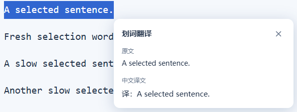

<p align="center">
  
</p>

<h1 align="center">旁译 Aside</h1>

<p align="center">网页双语、划词翻译与 YouTube 双语字幕。选一段文字，也能单独翻译。</p>

<p align="center">
  <a href="https://github.com/jking412/aside-translate/actions/workflows/ci.yml"></a>
  <a href="https://github.com/jking412/aside-translate/releases/tag/v0.3.0"></a>
  <a href="LICENSE"></a>
</p>

<p align="center">
  <a href="#下载安装">下载安装</a> · <a href="#功能">功能</a> · <a href="#界面预览">界面预览</a> · <a href="#翻译服务">翻译服务</a> · <a href="#验证状态">验证状态</a> · <a href="#开发">开发</a>
</p>

旁译是原生 JavaScript 编写的轻量 Chromium MV3 扩展，无账户和云同步，运行时没有 npm 依赖，也无需常驻 Node 服务。

> **v0.3.0：** 新增划词翻译：选中文字，在旁边点击“翻译”，用当前服务查看原文和中文译文；默认开启，可在弹窗或设置页关闭。延续此前的网页双语、字幕与空格修复。真实 YouTube 在线字幕仍受原版和新版共同遇到的空响应限制，详见[验证状态](#验证状态)。

## 下载安装

安装包解压后即可加载，**使用扩展不需要安装 Node.js**。

| 下载 | 用途 |
| --- | --- |
| [下载旁译 v0.3.0 扩展 ZIP](https://github.com/jking412/aside-translate/releases/download/v0.3.0/aside-translate-0.3.0.zip) | Chrome / Edge 等桌面 Chromium 浏览器，共用一个包 |
| [下载 SHA-256 校验文件](https://github.com/jking412/aside-translate/releases/download/v0.3.0/aside-translate-0.3.0.zip.sha256) | 校验 ZIP 文件完整性 |
| [查看版本说明与已知限制](https://github.com/jking412/aside-translate/releases/tag/v0.3.0) | v0.3.0 预发布页面 |

1. 下载上表 ZIP，解压到固定文件夹；文件夹内应直接包含 `manifest.json`。
2. Chrome 打开 `chrome://extensions`，Edge 打开 `edge://extensions`，开启“开发者模式”。
3. 选择“加载已解压的扩展”，选中解压后的文件夹；将旁译固定到工具栏，刷新准备翻译的网页。

更新时解压新包，在扩展管理页重新加载，再刷新已有网页。GitHub 自动生成的 **Source code** 是源码包，需要按[开发说明](#开发)构建后使用。目前未上架 Chrome / Edge 商店。

## 功能

| 功能 | 使用方式 |
| --- | --- |
| **网页翻译** | 保留原文，在段落后显示中文。点击页面悬浮球或工具栏“翻译此页”，再次点击恢复；支持拖动吸边、快捷面板、Alt+A / Alt+W、自动翻译与动态新增段落。 |
| **划词翻译** | 鼠标选中网页文字后，点击旁边的“翻译”按钮，在浮窗查看原文与中文。单纯选择不会发送请求；支持关闭、Esc、错误重试和长文本分段。 |
| **YouTube 双语字幕** | 打开有字幕的视频，自动触发 CC 并读取播放器原生字幕；提前翻译、按视频时钟显示原文与中文两行。播放器内可切换，拖动、换片和关闭时清理旧字幕。 |

网页翻译将内联文字合并为完整段落，保留原链接、强调和事件；译文使用安全恢复的对应行内元素。短行紧随原文，长段另起一行，滚动靠近后再翻译。供应商未保留有效格式标记、或单段富文本超过请求上限时，译文安全降为纯文本；原文的链接和事件继续保留。恢复时删除扩展自己的译文，页面应用后来的更新不会被旧快照覆盖。输入框、代码块和播放器区域不参与网页翻译。

字幕默认优先使用匹配的人工中文轨；缺少人工轨或关闭人工优先时，调用所选翻译服务。可在独立设置页控制人工优先与预先翻译。完整时间轴不可读时，尝试翻译播放器当前字幕，无法预译未来内容；接口慢时可能缺少译文。无字幕轨的视频不会从音频生成文字。

## 界面预览

<table>
  <tr>
    <td align="center"></td>
    <td align="center"></td>
  </tr>
  <tr>
    <td>默认弹窗，配置保持折叠。</td>
    <td>合成视频、人工双语输入的受控字幕演示。</td>
  </tr>
</table>

<p align="center"></p>

划词图片使用合成网页与回显测试服务，展示选区和浮窗交互，不代表线上翻译质量。

<p align="center"></p>

以上均为本项目自己的截图：弹窗图使用受控 Chrome API 替身；字幕图来自加载真实构建的隔离浏览器，输入是合成数据；DeepSeek 图来自实际扩展设置标签页，密钥为空。**字幕演示图不代表真实 YouTube 在线验收成功。** 原创图标的 [SVG 源文件](assets/icon.svg) 与多尺寸 PNG 均随仓库提供。

## 翻译服务

网页、划词和字幕共用一个“翻译服务”设置。可在弹窗编辑，或点击“在独立页面配置”打开不会随切页关闭的设置标签页。各供应商的未保存输入即时保留在本机，切到别处找密钥后可继续；点击保存才用于翻译。

| 服务 | 配置 |
| --- | --- |
| 微软翻译 | 新安装默认，无需密钥，使用与所供原版相同的 Edge 公共接口；可用性取决于网络和服务限制 |
| Google 公共服务 | 无需密钥，保留公共 gtx 接口及已有用户的服务选择 |
| LibreTranslate | 自备完整 `/translate` URL，密钥可选 |
| OpenAI 兼容 | 提供 OpenAI、DeepSeek、通义千问、智谱、Moonshot、豆包、硅基流动、Mistral、Groq、OpenRouter 端点预设，也可自定义接口 |
| Anthropic Messages | 原生协议，自备接口、模型 ID 和密钥 |
| Google Gemini | 原生 generateContent 协议，自备 API 基址、模型 ID 和密钥 |

**DeepSeek 选择后已填好地址和默认模型 `deepseek-flash`**，通常只需自己的 API 密钥；可从建议中选择 `deepseek-v4-pro` 或填写自定义模型。其他 AI 服务使用自己账户可用的模型 ID。各服务的地区端点、套餐、模型权限和计费可能不同，详见 [AI 服务配置与官方依据](docs/ai-services.md)。

## 权限与隐私

- 自动网页翻译默认关闭；所有 HTTP(S) 网站访问在安装时声明，用于网页悬浮入口、网页/划词翻译和自备服务。使用翻译功能、开启自动翻译或保存服务时均不再弹出权限申请。
- 浏览器仍可能在安装或升级增加权限时告知一次。可在扩展详情限制网站访问；关闭自动翻译会恢复已连接网页。
- **文字会发送到所选翻译服务。** 自动翻译可能发送页面中的个人信息；在敏感页面使用前，请先确认是否允许发送。
- 设置、未保存草稿与密钥仅存本机 `chrome.storage.local`，不启用同步，不持久化网页正文；密钥在本地未加密。AI 请求可能产生服务商费用。

完整说明见 [隐私说明](PRIVACY.md)。扩展不包含 OCR、语音模型、文档处理、术语库、账户和同步模块。

## 验证状态

| 范围 | 本次结果 |
| --- | --- |
| 单元和隔离浏览器测试 | 协议、段落识别、原文与事件保留、动态更新、视口调度、配置草稿、悬浮入口、原生字幕捕获与时钟；正式 manifest 不作权限预授予改写 |
| 默认微软真实翻译 | 已在真实扩展后台返回“你好，世界。”；富文本标记也保留 |
| 真实 YouTube | 新版和原版同视频、同机独立配置都收到空字幕正文，在线双语显示未通过；见[验证记录](docs/verification.md) |
| 云 AI 真实鉴权调用 | 未使用用户密钥或计费服务；协议通过单元和本机 HTTP 测试 |

目标为桌面 Chrome / Edge 120+。浏览器内部页、扩展商店、PDF、封闭 Shadow DOM 和画布文字不参与网页翻译。普通 HTTP(S) iframe 使用独立内容脚本处理。原版私有站点规则库未复制，复杂网站、地区/账号差异、直播与广告仍需持续验证。

完整证据、复现方法及已知限制见 [验证记录](docs/verification.md)；构建状态见 [GitHub Actions](https://github.com/jking412/aside-translate/actions)。

## 开发

需要 Node.js 22+ 与 npm。

```shell
git clone https://github.com/jking412/aside-translate.git
cd aside-translate
npm ci
npm run build
```

构建输出为 `dist/`，按前面的步骤加载。只修改源码后需要重新构建、重新加载扩展并刷新网页。

```shell
npx playwright install chromium
npm run verify
npm run package
```

`verify` 包含语法/权限/图标检查、单元测试、构建、隔离浏览器测试及划词交互检查。真实网络探测单独运行 `npm run test:online`，无真实双语字幕时返回非零。已有独立 Chromium 时，可将 `ASIDE_CHROMIUM_PATH` 设为其可执行文件绝对路径。CI 使用固定版本官方 Playwright 容器。

| 目录 | 职责 |
| --- | --- |
| `src/background` | 翻译请求、队列、设置入口和跨帧动作 |
| `src/content` | 网页翻译、播放器桥接和字幕显示 |
| `src/shared` | 配置、服务协议、字幕时间轴与服务预设 |
| `src/popup` / `src/options` | 中文弹窗、持久设置页与供应商草稿编辑 |
| `assets` | 原创图标源与各尺寸 PNG |
| `tools` / `tests` | 构建、验证与打包 |

`npm run package` 在 `release/` 生成扩展 ZIP 和 SHA-256。发布流程见 [发布说明](docs/release.md)。测试原始输出、临时媒体、测试浏览器资料、密钥配置、`node_modules`、`dist` 和 `release` 均不进入 Git；README仅收录已审查的自有演示图片。

## 贡献与许可

欢迎提交问题和改进建议，见 [贡献说明](CONTRIBUTING.md)与[问题反馈](https://github.com/jking412/aside-translate/issues)。原创代码和图标采用 [MIT](LICENSE)，第三方工具及旧素材授权检查见 [第三方声明](THIRD_PARTY_NOTICES.md)。

README 的信息结构参考 [awesome-readme](https://github.com/matiassingers/awesome-readme) 收录的 Sniffnet、GitPoint，以及相关翻译扩展的安装文档；仅借鉴章节组织，文字与图片均来自本项目。选取理由和来源见 [README 结构参考](docs/readme-references.md)。
